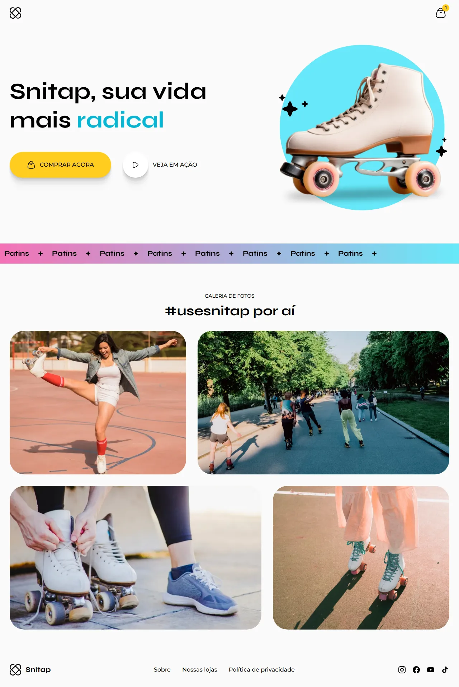
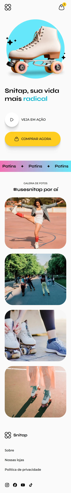

# Snitap — Landing Page Animada

<p align="center">
  <strong>Landing page animada de uma marca de patins, desenvolvida com HTML, CSS, JavaScript, GSAP e Lenis.</strong>
</p>

<p align="center">
  
  
  
  
  
  
  
</p>

<p align="center">
  <a href="https://montenegroengcomp.github.io/Landing-Page-Animada/"></a>
</p>

<p align="center">
  <a href="#demonstração-visual">Demonstração visual</a> •
  <a href="#animações-e-interações">Animações e interações</a> •
  <a href="#responsividade">Responsividade</a> •
  <a href="#tecnologias">Tecnologias</a> •
  <a href="#estrutura-de-pastas">Estrutura de pastas</a> •
  <a href="#pré-requisitos">Pré-requisitos</a> •
  <a href="#execução">Execução</a> •
  <a href="#decisões-técnicas">Decisões técnicas</a> •
  <a href="#validações-realizadas">Validações realizadas</a> •
  <a href="#autora">Autora</a>
</p>

---

Página de apresentação da **Snitap**, uma marca fictícia de patins, com hero, faixa em movimento, galeria de fotos dos clientes (**#usesnitap**) e rodapé.

O foco do projeto é **animação**: cada seção tem movimento próprio, controlado por **GSAP** e **ScrollTrigger**, com rolagem suave feita pelo **Lenis**. O layout segue o modelo *LP de patins animada*, disponível na Figma Community, e as animações do protótipo foram ampliadas com novas interações.

🔗 **Acesse:** https://montenegroengcomp.github.io/Landing-Page-Animada/

## Demonstração visual

<p align="center">
  
</p>

<p align="center">
  
</p>

## Animações e interações

### Entrada da página

- O header desce do topo e o título sobe linha por linha, revelado por uma máscara.
- O círculo azul cresce com efeito elástico, o patins "cai" girando até o lugar e as estrelas surgem em sequência.
- Os botões aparecem em cascata logo depois do título.

### Hero

- **Palavra que muda**: *radical*, *divertida* e *saudável* se alternam em loop, cada uma com a sua cor, e a largura do espaço acompanha a palavra atual.
- O patins flutua continuamente e as estrelas piscam em ritmos diferentes.
- **Parallax com o mouse**: círculo, patins e estrelas se movem em profundidades diferentes, e o patins inclina levemente para o lado do cursor.
- Ao rolar a página, o patins desliza e gira para a direita, como se saísse rodando.

### Botões

- **Botões magnéticos**: *Comprar agora* e *Veja em ação* seguem o cursor e voltam com efeito elástico.
- Brilho que atravessa o botão principal e ícone que gira no hover.
- Onda pulsante ao redor do botão de play.

### Carrinho

- Ao clicar em **Comprar agora**, uma miniatura do patins voa em arco até o carrinho.
- O ícone do carrinho balança, o contador aumenta e um aviso confirma a compra.
- O aviso também é anunciado por leitores de tela (`aria-live`), e o rótulo do carrinho é atualizado com a quantidade de itens.

### Faixa "Patins"

- Loop infinito sem emenda, com as estrelas girando.
- A faixa **reage à rolagem**: muda de direção conforme o sentido do scroll, acelera de acordo com a velocidade e se inclina levemente.

### Galeria

- Os cards de cada linha entram vindos de lados opostos, com uma máscara (`clip-path`) que se abre a partir do centro.
- As fotos têm parallax dentro dos cards durante a rolagem.
- No hover (ou foco pelo teclado), a foto aproxima e o perfil do Instagram sobe com um degradê.

### Header, rodapé e navegação

- Header com fundo desfocado, que some ao rolar para baixo e volta ao rolar para cima.
- Barra de progresso da rolagem no topo, com o degradê da marca.
- Logo gira no hover; links do rodapé com sublinhado animado e ícones sociais com círculo amarelo que cresce.
- O rodapé entra em cascata ao aparecer na tela.

### Acessibilidade do movimento

Com **movimento reduzido** ativado no sistema (`prefers-reduced-motion`), a rolagem suave, o parallax e as animações decorativas são desligados; o conteúdo aparece imediatamente e o carrinho continua funcionando, sem a animação de voo.

## Responsividade

O layout se adapta a três faixas de largura:

| Faixa | Hero | Botões | Galeria | Rodapé |
| --- | --- | --- | --- | --- |
| Desktop (acima de 900px) | Título à esquerda e imagem à direita | Lado a lado | 2 colunas, com proporção 488 : 696 alternada | Em linha |
| Tablet (até 900px) | Imagem acima do título | Empilhados, com *Veja em ação* primeiro | 2 colunas, com cards mais baixos | Em coluna |
| Celular (até 640px) | Imagem acima do título | Empilhados | 1 coluna, cards de 256px | Em coluna |

Os tamanhos de título, espaçamentos laterais e imagem do hero usam `clamp()`, então variam de forma contínua entre o layout mobile (360px) e o desktop (1280px). Em telas de toque, que não têm hover, o perfil do Instagram fica sempre visível nos cards.

## Tecnologias

| Camada | Tecnologia | Versão |
| --- | --- | --- |
| Estrutura | HTML | 5 |
| Estilo | CSS (Custom Properties, Grid, Flexbox, `clamp()`, `clip-path`) | 3 |
| Comportamento | JavaScript (ES Modules) | ES2020 |
| Animação | [GSAP](https://gsap.com/) + ScrollTrigger | 3.15 |
| Rolagem suave | [Lenis](https://lenis.darkroom.engineering/) | 1.3 |
| Build e servidor local | [Vite](https://vite.dev/) | 8 |
| Tipografia | Google Fonts — Syne, Montserrat e Inter | — |
| Deploy | GitHub Actions + GitHub Pages | — |

### Design tokens

As cores, estilos de texto, sombras e curvas de animação ficam centralizados em [`src/styles/tokens.css`](src/styles/tokens.css):

| Token | Valor | Uso |
| --- | --- | --- |
| `--color-bg` | `#FAFAFA` | Fundo da página |
| `--color-yellow` | `#FFCD1E` | Botão principal, contador do carrinho e hover dos ícones sociais |
| `--color-cyan` | `#06B6D4` | Palavra *radical* e sublinhado dos links |
| `--color-pink` | `#DB2777` | Palavra *divertida* |
| `--color-green` | `#16A34A` | Palavra *saudável* |
| `--gradient-brand` | `#F472B6` → `#67E8F9` | Faixa e barra de progresso |
| `--text-display` | Syne Bold 32px a 64px / 125% | Título do hero |
| `--text-h2` | Syne Bold 24px a 40px / 120% | Título da galeria |
| `--text-button` | Montserrat Medium 16px / 150% | Botões e links |
| `--shadow-button` | 5 camadas exportadas do Figma | Sombra dos botões |
| `--ease-out` / `--ease-spring` | `cubic-bezier` | Curvas das transições em CSS |

## Estrutura de pastas

```text
.
├── .github/workflows/
│   └── deploy.yml          # Build e publicação no GitHub Pages
├── docs/                   # Capturas de tela usadas no README
├── public/
│   └── favicon.svg
├── src/
│   ├── assets/
│   │   ├── icons/          # Logo, ícones dos botões e redes sociais (SVG)
│   │   └── images/         # Patins, fotos da galeria (WebP) e formas do hero (SVG)
│   ├── js/
│   │   ├── intro.js        # Timeline de entrada da página
│   │   ├── word-rotator.js # Palavra que muda no título
│   │   ├── hero.js         # Flutuação, estrelas, parallax com o mouse e saída na rolagem
│   │   ├── marquee.js      # Faixa infinita que reage à rolagem
│   │   ├── scroll-reveal.js# Revelação da galeria, parallax das fotos e rodapé
│   │   ├── header.js       # Header que some/aparece e barra de progresso
│   │   ├── magnetic.js     # Botões magnéticos
│   │   ├── cart.js         # Animação de adicionar ao carrinho e aviso
│   │   ├── smooth-scroll.js# Lenis e links internos
│   │   └── utils.js        # Preferências do usuário e debounce
│   ├── styles/
│   │   ├── main.css        # Ponto de entrada: importa os demais arquivos
│   │   ├── tokens.css      # Design tokens
│   │   ├── base.css        # Reset, container e estados iniciais das animações
│   │   ├── components.css  # Botões, links, ícones sociais e aviso
│   │   ├── header.css
│   │   ├── hero.css
│   │   ├── marquee.css
│   │   ├── gallery.css
│   │   └── footer.css
│   └── main.js             # Inicializa os módulos
├── index.html
├── package.json
└── vite.config.js
```

## Pré-requisitos

- [Node.js](https://nodejs.org/) 20 ou superior (com npm)
- [Git](https://git-scm.com/), para clonar o repositório
- Um navegador atualizado (Chrome, Edge, Firefox ou Safari)

## Execução

O projeto está publicado no GitHub Pages: https://montenegroengcomp.github.io/Landing-Page-Animada/

Para executar localmente, clone o repositório e instale as dependências:

```bash
git clone https://github.com/MontenegroEngComp/Landing-Page-Animada.git
cd Landing-Page-Animada
npm install
```

Depois, use um dos scripts:

| Comando | O que faz |
| --- | --- |
| `npm run dev` | Inicia o servidor de desenvolvimento em `http://localhost:5173`, com recarregamento automático |
| `npm run build` | Gera a versão otimizada para produção na pasta `dist/` |
| `npm run preview` | Serve a pasta `dist/` localmente para conferir o build |

A cada push na branch `main`, o workflow [`deploy.yml`](.github/workflows/deploy.yml) gera o build e publica no GitHub Pages (em **Settings → Pages**, a fonte deve estar como **GitHub Actions**).

## Decisões técnicas

- **GSAP + ScrollTrigger**: timelines deixam a entrada da página coreografada em um só lugar, e o ScrollTrigger liga as animações à rolagem sem cálculos manuais de posição.
- **Lenis sincronizado com o GSAP**: o Lenis roda no mesmo ticker do GSAP, então rolagem suave e animações de scroll ficam sempre no mesmo quadro, sem tremidas.
- **Um módulo por animação**: cada efeito vive no seu arquivo em `src/js/`, e o [`main.js`](src/main.js) apenas decide o que iniciar, inclusive conforme a preferência de movimento.
- **Faixa infinita no ticker**: em vez de uma animação CSS fixa, a posição é calculada a cada quadro com `gsap.utils.wrap`, o que permite inverter a direção e acelerar com a rolagem sem saltos.
- **Transforms independentes**: a centralização usa a propriedade CSS `translate`, e o GSAP anima `transform`; assim entrada, flutuação, parallax e rolagem se combinam no mesmo elemento sem um sobrescrever o outro.
- **`gsap.quickTo` para o mouse**: parallax e botões magnéticos reaproveitam uma única animação por propriedade, em vez de criar uma nova a cada movimento do cursor.
- **Sem flash de conteúdo**: o hero começa oculto só quando o JavaScript está ativo (classe `js` no `<html>`), e uma animação CSS de segurança revela tudo após 2,5s caso o script falhe.
- **Imagens otimizadas**: as fotos exportadas do Figma foram convertidas de PNG para WebP (de cerca de 6 MB para 580 KB), com `width`/`height` definidos para evitar saltos no layout e `loading="lazy"` na galeria.
- **Assets processados pelo Vite**: imagens e ícones ficam em `src/assets/` e recebem hash no nome no build, permitindo cache de longo prazo.
- **Acessibilidade**: HTML semântico (`header`, `main`, `section`, `figure`, `nav` e `footer`), link para pular ao conteúdo, título com `aria-label` completo (a palavra animada fica oculta para leitores de tela), cards acessíveis pelo teclado, foco visível, textos alternativos descritivos e respeito a `prefers-reduced-motion`.

## Validações realizadas

| Validação | Resultado |
| --- | --- |
| Comparação com o layout do Figma em 1280px | Seções, espaçamentos, tipografia, cores e assets conforme o modelo |
| Comparação com o layout mobile do Figma em 360px | Imagem acima do título, botões empilhados e galeria em uma coluna |
| Rolagem horizontal em 360px e 1280px | Nenhuma |
| Console do navegador | Sem erros |
| Animação de adicionar ao carrinho | Miniatura voa até o carrinho, contador passa de 1 para 2 e o rótulo vira "Carrinho: 2 itens" |
| Hover nos cards da galeria | Foto aproxima e o perfil do Instagram aparece |
| Movimento reduzido ativado | Conteúdo visível de imediato, sem animações decorativas e sem erros |
| Build de produção (`npm run build`) | Concluído com sucesso, com cerca de 53 kB de JavaScript (gzip) |

## Autora

**Clarisse Maria Cabral Montenegro**
